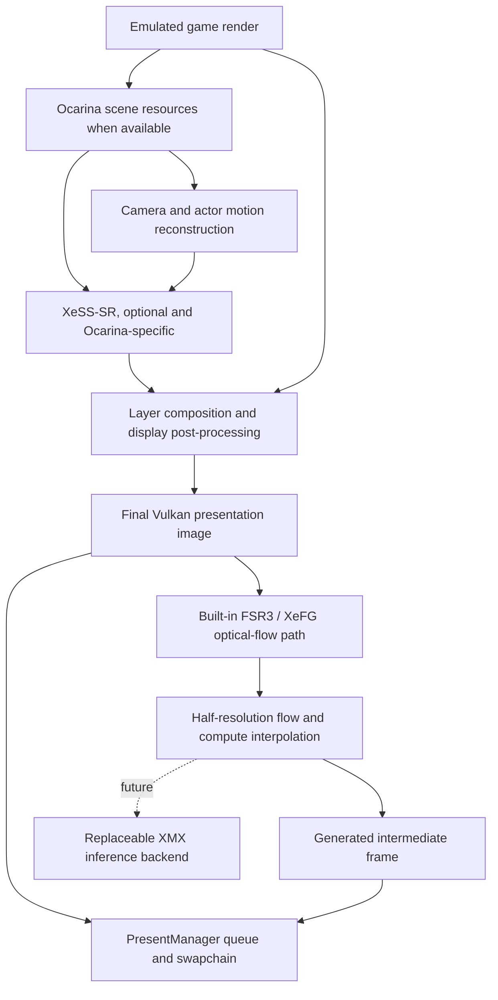

# XeFG-VK Research and MVP

## Status

XeFG-VK is an experimental, presentation-only frame-generation research project. This branch is based on the repository's existing `feature/ocarina-render-scale-1080p` XeSS branch at `855c09d877e1720a58566b2c54bc597676ec0be3`. The requested ref `feature/ocarina-render-scale-1080` does not exist in this checkout; the actual branch name includes the trailing `p`.

| Stage | Status |
| --- | --- |
| Separate XeFG color capture | Helper remains in source but is removed from the active renderer path; no duplicate color-history copies are made |
| Vulkan device capability query | A750 driver queried with `vulkaninfo`; cooperative-matrix extension and feature exposed |
| Matrix shape query | Not verified on this machine; `vulkaninfo` did not print the shape list |
| XMX instruction execution | Not verified |
| MVP 2/3: motion estimation, interpolation, generated-frame presentation | XeFG mode reuses Lichii's Vulkan optical-flow/interpolation and bounded presentation pipeline; not compiled or run yet |
| A750 frame-generation performance | Not measured |

The host reports an Intel Arc A750, Intel Vulkan driver `101.9175`, `VK_KHR_cooperative_matrix` revision 2, `cooperativeMatrix=true`, compute-stage support, `VK_KHR_external_memory_win32`, and `VK_KHR_timeline_semaphore`. These properties establish that the driver exposes a candidate Vulkan matrix path; they do not prove a specific shape is supported or that a shader dispatch executes on XMX.

## Architecture



`XeFGVKCapture` is no longer constructed or called from `RendererVulkan::Composite`. Its source files remain in the tree, but `EDEN_XEFG_CAPTURE` has no runtime effect. The active renderer uses only the history images owned by `Fsr3FrameGen`.

The UI now offers `XeFG (Optical Flow, 2x)`. This mode uses the existing `Fsr3FrameGen` GPU optical-flow and interpolation implementation and the existing bounded presentation queue, capped at one generated frame per real frame. It is an MVP algorithm, not a neural model and not XMX inference. Inference is explicitly reported unavailable. When the existing flow-dump debug option is enabled, XeFG writes a one-shot, colorized half-resolution motion-vector image to the user data `lossless/debug` directory. That debug readback waits for the GPU and should not be used for performance measurements.

## Renderer and XeSS Data Flow

The generic Vulkan path is:

1. `RendererVulkan::Composite` obtains a presentation `Frame` from `PresentManager`.
2. `BlitScreen::DrawToFrame` composites guest framebuffer layers and display processing into `Frame::image`.
3. `Scheduler::Flush(*frame->render_ready)` submits the recorded rendering work and signals the frame-ready semaphore.
4. `PresentManager` copies or blits the frame to the swapchain and presents it. Its frame pool uses `render_ready`, `present_done`, and the scheduler's GPU timeline for resource and queue lifetime.

The presentation image already has transfer-source usage and ends the render pass in `GENERAL`. The final composition includes all layers supplied to the compositor, including HUD and menus. The dormant XeFG color-capture helper is not used by the active pipeline.

The personal XeSS-SR integration remains intact and is game-specific to Ocarina of Time:

- `OcarinaUpscaler::Impl` creates `XessUpscaler` for the selected XeSS backend. `XessUpscaler` dynamically loads the user-supplied Intel XeSS runtime, creates a Vulkan XeSS context, and schedules initialization and evaluation through `Scheduler`.
- The scene color is prepared in per-frame `OcarinaFrameSlot` images. The XeSS path uses an XeSS-specific color conversion image, the scene depth image, and a motion image in `VK_FORMAT_R16G16_SFLOAT`.
- `CameraMotionPass` reconstructs camera motion from current and previous transforms plus depth. When actor data is available, `ActorOverlay` adds actor motion. This is host-reconstructed motion, not a general source of motion vectors from arbitrary emulated games.
- XeSS writes an `R16G16B16A16_SFLOAT` output image. When the selected input/output geometry needs an intermediate, Lichii blits that result to the configured output extent. The output pass places the selected upscaler result in the Ocarina composite target; later compositor work sends the visible frame toward the swapchain.

The exact XeSS runtime and its model are not used by XeFG-VK. No XeSS-SR source files are changed by the MVP.

## Motion and Frame Inputs

| Input | Current availability |
| --- | --- |
| Current color | Available at the final compositor and passed directly to `Fsr3FrameGen::Process` |
| Previous color | Stored in `Fsr3FrameGen`'s current/history images; no second capture ring is active |
| Depth | Available in the Ocarina-specific scene/upscaler path; not exposed by the generic compositor |
| Motion vectors | XeFG estimates image-space motion from consecutive final-compositor colors; Ocarina also has reconstructed camera/actor motion, not currently wired into generic XeFG |
| Camera/object transforms | Available only through game-specific Ocarina hooks used by its motion pass |
| Frame timing | `EDEN_FSR3_FG_TRACE=1` reports host event timestamps and scheduler GPU timestamps for instrumented FSR3 work |
| Render/output resolution | Present in Ocarina upscaler inputs and in the presentation `Frame` dimensions |

The current XeFG mode uses the existing image-space optical flow and resets its history after host frame gaps over 250 ms. Scene-cut, menu, loading, and camera-discontinuity detection is not implemented yet.

For Ocarina, the lower-resolution scene inputs preserve depth and reconstructed motion and reduce the pixel count for optical flow or inference. Generating before XeSS would require a compatible upscale of the generated image and careful management of XeSS's temporal history. Generating after XeSS reduces dependence on the lower-resolution input path and has a sharp output image, but costs more pixels and receives already-upscaled content. The active FSR3 path instead receives final-compositor color, so its optical flow also sees UI and overlays and has no depth input. Ocarina's reconstructed depth/motion is game-specific and is not wired into this general FG path; a better insertion point is not selected.

## XMX Backend Research
## Source-Level Baseline and Bottlenecks

These are source-derived workload characteristics, not measured performance results:

- For an output extent `W x H`, flow resources are `max(1,W/2) x max(1,H/2)`, so the flow dispatch covers roughly one quarter of output pixels in 16x16 workgroups.
- After initialization, every real frame copies the prior current image to history and the new compositor frame to current. Each generated output then runs a full-resolution interpolation dispatch.
- The flow shader compares one current luma sample against a fixed four-point radius-2 diamond and a four-point radius-1 refinement. At half resolution, this search is limited to about six output pixels per component for even extents; motion beyond that window is likely to mismatch.
- `search_radius` and `block_size` are pushed to the flow shader but not read there. `flow_scale` is pushed to the interpolation shader but not read there. Verify these candidate configuration issues with controlled scenes and traces before changing behavior.
- Flow matching is single-channel luma with a per-sample absolute difference and distance penalty; it has no confidence or forward/backward consistency test. Interpolation uses componentwise median motion and RGB difference for occlusion, with no depth/disocclusion input. These choices can produce mismatches on flat/repeating textures, edge bleeding, and ghosting at disocclusions.
- The trace can measure history-copy and dispatch GPU intervals, but no A750 measurements, visual A/Bs, FPS deltas, or performance baseline have been collected.

## Proposed Experiments

Ranked by expected value and risk; benchmark each change independently before retaining it.

| Rank | Candidate | Expected benefit | Risk |
| --- | --- | --- | --- |
| 1 | Collect baseline traces and scene captures on the A750 | Identifies whether copies, flow, interpolation, or pacing dominate | Low; diagnostics add overhead, so final FPS runs must disable tracing |
| 2 | Reduce history-copy traffic with same-scheduler ping-pong images and descriptor sets safe for in-flight use | Potentially large bandwidth reduction | Medium/high; descriptor/resource lifetime changes can race queued work |
| 3 | Test a wider or coarse-to-fine search against fast-motion captures | Better motion coverage and fewer large-motion mismatches | High; more samples/levels can raise GPU cost and introduce false matches |
| 4 | Add motion confidence and forward/backward occlusion rejection | Fewer ghosts and disocclusion leaks | Medium/high; requires a robust GPU flow representation and quality corpus |
| 5 | A/B workgroup size, shared-memory usage, and image formats on Intel Arc | Possible occupancy/cache improvement | Medium; benefit is driver/GPU-specific and currently unknown |

No shader algorithm or workgroup changes are made in this instrumentation stage.

## XMX Backend Research

### Vulkan cooperative matrices

The real Vulkan extension is [`VK_KHR_cooperative_matrix`](https://docs.vulkan.org/refpages/latest/refpages/source/VK_KHR_cooperative_matrix.html). It defines cooperative SPIR-V matrix operations and a query for implementation-supported shapes and component types. The application must query both the extension/features and `vkGetPhysicalDeviceCooperativeMatrixPropertiesKHR`; extension presence alone is insufficient. The Vulkan specification does not guarantee that an implementation maps those operations to a particular physical matrix engine.

Lichii already has capability querying and a correctness self-test for guest HMMA cooperative-matrix operations in `vulkan_device.cpp` and `vk_cooperative_hmma_test.cpp`. Its accepted 16x8x16 or 16x16x16 FP16 shapes are chosen for emulating a guest instruction; they are not an XeFG inference backend and the correctness self-test does not identify XMX instruction selection. When XeFG is selected, it now queries and logs the device's reported matrix shapes, types, and scope. The A750's shape list has not yet been observed in a Lichii run, and generated machine instructions remain unverified.

### Level Zero and SYCL

Intel's [`ZE_intel_device_module_dp_exp_properties_t`](https://github.com/intel/compute-runtime/blob/master/level_zero/doc/experimental_extensions/MODULE_DP_SUPPORT.md) adds a `DPAS` capability query through `zeDeviceGetModuleProperties`. Intel's open-source compute runtime is MIT-licensed and contains Xe HPG support. This is a credible way to confirm a driver-reported DPAS path, but it is a separate API submission path. No Vulkan-image sharing, cross-API semaphore protocol, runtime installation, or end-to-end Lichii integration has been validated here; copying full-resolution images between APIs would likely defeat the latency and bandwidth goal.

Intel's [`sycl_ext_intel_matrix`](https://github.com/intel/llvm/blob/sycl/sycl/doc/extensions/experimental/sycl_ext_matrix/sycl_ext_intel_matrix.asciidoc) describes Intel AMX/XMX matrix operations. It is explicitly experimental and the documentation cautions against relying on it in shipping products. Intel DPC++ is Apache-2.0 with LLVM exceptions. Its current end-to-end tests include DG2 (`gpu-intel-dg2`) expected failures, which matters because Arc A750 is DG2. SYCL is therefore not selected as the first backend.

The preferred investigation order is:

1. Query the A750's exact Vulkan cooperative-matrix shapes from Lichii's Vulkan device and create a small, isolated matrix workload.
2. Prove instruction selection on the Intel driver using available compiler/disassembly or vendor performance evidence; a successful Vulkan dispatch alone is not XMX proof.
3. Compare the same workload with Level Zero DPAS. Only consider that backend if device matching, resource sharing, semaphore interop, and measured overhead are acceptable.
4. Keep model loading/inference separate from motion processing. The XeSS-FG network is not extracted or redistributed; a future model must have independently verified provenance and licensing.

## Support and Requirements

- **MVP 1 through 3:** uses Vulkan image transfer/compute operations already used by the renderer and existing FSR3 optical-flow shaders. No Intel SDK, runtime DLL, or model is required.
- **Future Vulkan matrix backend:** requires `VK_KHR_cooperative_matrix`, the enabled cooperative-matrix feature, and a queried shape/type combination suitable for its model. The exact A750 combination is still unknown.
- **Future Level Zero backend:** would require an Intel Level Zero runtime/compiler path reporting DPAS and validated sharing of the Lichii Vulkan device's resources and synchronization. This is not a dependency today.
- **Future SYCL backend:** would require an Intel DPC++ installation and its Intel matrix extensions. The relevant Intel extension is experimental and not selected.
- **Target hardware:** Intel Arc A750, 8 GB, Windows. The installed driver observed here is `101.9175`; no minimum Intel driver version is claimed or certified by this MVP.
- **Other GPUs:** MVP color capture is not Intel-specific. No GPU is yet certified for frame generation or an XMX path.

`VK_KHR_external_memory_win32` and timeline semaphores were exposed by the queried A750 driver, but no Level Zero import/export path has been implemented. A future cross-API backend must establish device identity, allocation compatibility, semaphore interop, and measured overhead before it can be considered viable.

### Relevant source and licensing

| Project/source | License | Relevant technique | Windows/Lichii relevance |
| --- | --- | --- | --- |
| Lichii `vk_cooperative_hmma_test.cpp` and Vulkan device capability checks | GPL-3.0-or-later | Queries supported KHR cooperative-matrix properties and validates guest HMMA results | Already in the Windows Vulkan renderer; not proof of XMX selection |
| Intel `compute-runtime` | MIT | Level Zero DPAS capability reporting and Xe HPG runtime support | Potential separate Intel backend; resource and synchronization interop still unproven |
| Intel LLVM/DPC++ matrix extensions | Apache-2.0 WITH LLVM-exception | SYCL `joint_matrix` and Intel XMX APIs | Windows is represented in tests, but DG2 failures and experimental status make it unsuitable as the first production dependency |
| Khronos Vulkan cooperative matrix | Vulkan specification | Vendor-neutral matrix operations and shape discovery | Available on this A750 driver; physical execution path still must be proved |

No external source code or model was copied into the MVP. The existing user-provided XeSS runtime remains a separate XeSS-SR dependency.

## Synchronization and Pacing

FSR3 history copies, optical flow, and interpolation are recorded on the existing scheduler. Generated images use normal presentation frames; the present thread waits for `render_ready` and the frame is not recycled until its present fence signals. `FrameGenPacer`, bounded frame availability, and present spacing remain the pacing controls. No emulated CPU/GPU timing, input polling, game logic, or audio timing is changed.

The `XeFG (Optical Flow, 2x)` selector currently routes through the existing `Fsr3FrameGen` implementation and caps generation to one intermediate per real frame. It does not create another present thread or queue. Any future backend should continue using that path and avoid unbounded queued frames or CPU waits for inference.

## Build and Runtime

The built-in optical-flow path adds no SDK or third-party dependency. Build using the repository's existing Windows Vulkan/CMake environment, for example:

```powershell
cmake -S . -B build -G Ninja -DCMAKE_BUILD_TYPE=Release
cmake --build build --parallel
```

The `XeFG (Optical Flow, 2x)` frame-generation type is selected in Lichii's existing frame-generation settings; enable frame generation and choose this type. Set `EDEN_FSR3_FG_TRACE=1` before launch for one-second FG summaries and per-event timestamps. This records CPU process/record wall time separately from Vulkan GPU timestamps. GPU counters cover only the labeled history-copy, flow-dispatch, and interpolation-dispatch scopes, not all FG barriers or the whole frame. Present timestamps are host times when `vkQueuePresentKHR` returns, not display scanout times. The trace's delay count is readiness later than the present-thread due time, and repeated-image detection is unavailable. The existing flow-dump option writes a motion visualization for XeFG; that debug readback is blocking and must be disabled for performance runs. No XMX/Level Zero runtime DLL dependency has been added.

## Validation and Measurements

- Repository: feature work is on `feature/xmx-xefg-vk`, based at the XeSS branch commit shown above. The XeSS branch itself is unchanged.
- Source diagnostics: VS Code reported no errors in the trace, scheduler, present-manager, swapchain, and renderer files. `frame_gen.cpp` and `fsr3_frame_gen.cpp` could not be fully parsed because this workspace has no configured C++/Vulkan include paths or generated shader headers.
- Patch hygiene: `git diff --check` passed.
- Build/tests: not run. No compiler, CMake, Ninja, or configured build tree is available in this environment.
- Vulkan runtime: `vulkaninfo` identified the Intel Arc A750 and reported the cooperative-matrix extension/feature, Win32 external memory, and timeline semaphore. It did not expose cooperative-matrix shape details. XeFG now logs the shape list when selected, but that code has not been run.
- Built-in FG interpolation execution: not run on this branch.
- Baseline/after FPS, GPU time, frame quality, latency, VRAM, CPU overhead, and XMX execution: not measured. No improvement is claimed.
- `EDEN_FSR3_FG_TRACE=1` records real inputs, generated-frame records, successful/suboptimal presents, drops, readiness lateness, frame-pool waits, CPU process/record wall time, and scheduler GPU timestamp scopes for FSR3 history copies and compute dispatches. GPU figures are the sum of those named scopes, not whole-frame GPU time. Repeated-image detection is unavailable.

## Test Plan

Before enabling generated frames, validate the capture and capability paths separately:

- **Hardware:** Intel Arc A750 on Windows; a non-Intel Vulkan GPU; and an Intel GPU/driver without a usable matrix path to verify graceful feature disablement.
- **Vulkan:** enumerate cooperative-matrix extension and feature support, list every reported matrix shape/type/scope, check the exact compute queue and image-format usages, query timeline semaphores, and check external-memory/semaphore capabilities only for an interop experiment.
- **Frame generation:** static scene, moving camera, moving objects, resize, format/HDR changes, dropped/hidden frames, and history reuse under Vulkan validation.
- **Temporal transitions:** particles/transparency, HUD, menus, cutscenes, loading transitions, camera cuts/teleports, and variable frame intervals. Verify history reset and that the game simulation/input/audio timing remains unchanged.
- **Performance:** use `EDEN_FSR3_FG_TRACE=1` to diagnose scoped work, then compare native and generated FPS, whole-frame GPU time, queue/present latency, VRAM, CPU overhead, and artifacts in the same scene/driver run with tracing off. The trace adds timestamp work and is not the final performance result. No before/after measurements have been collected yet.

Known image artifacts cannot yet be assessed because there is no generated frame. Expected risks for a future interpolation algorithm include disocclusion holes, transparency/particle ghosting, camera-cut blends, and UI trails.

## Remaining Work

1. Build the branch and run the existing FSR3/XeFG mode with Vulkan validation; verify image reuse, resize, reset, and present ordering.
2. Move XeFG input before UI composition and add a resource-provider contract for color, depth, motion, and reset metadata.
3. Run XeFG on the A750 to capture exact cooperative-matrix shapes, then implement a standalone matrix inference dispatch and prove XMX/DPAS execution from compiler or vendor evidence.
4. Evaluate quality across camera/object motion, particles, UI, menus, cutscenes, and loading transitions; add history-reset rules.
5. Add a replaceable, independently licensed neural model and measure latency, GPU time, frame pacing, memory, and image quality on the A750.